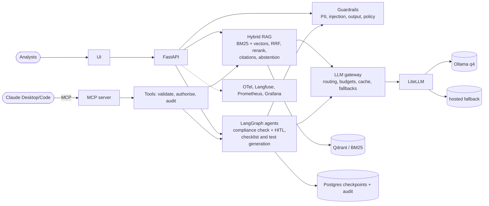

# RegIntel - Agentic Compliance Intelligence Platform

> Ask questions about regulations and get cited answers, check company policies against the
> rules with a multi-agent workflow and human review, and measure everything. Runs fully local:
> offline for CI, open models via Ollama for real use.

[](https://github.com/Krishna0485/Ai_Architecture_Project/actions/workflows/regintel-ci.yml)
[](https://github.com/Krishna0485/Ai_Architecture_Project/actions/workflows/regintel-eval.yml)
[](#testing)
[](pyproject.toml)
[](LICENSE)


<!-- Record with: make dev + make ui -> ask a question, run a check, approve a finding, open the trace. -->

## Why this project

Compliance teams answer questions, check documents and track obligations across regulations
that change often, and a wrong answer costs money. RegIntel combines grounded retrieval with a
bounded agent workflow. Every answer cites the section it came from, abstains when the indexed
text doesn't support an answer, and treats uploaded documents as untrusted input. A human
approves findings before anything is final. Quality, cost and security are measured by scripts
in this repo, not asserted.

## Architecture



- **Retrieval:** BM25 and vectors fused with Reciprocal Rank Fusion, then reranked. Tenant and
  group filters are applied *inside* the stores.
- **Generation:** versioned prompts; numbered `<untrusted>` passages; `[n]` citations mapped back to
  real chunk ids (invented ones dropped); abstention by IDF-weighted query coverage.
- **Agents:** a fixed LangGraph graph with a quarantine boundary. Only tool-less, schema-validated
  nodes read uploads. `interrupt()` pauses for human review; state is checkpointed in Postgres.
- **Gateway:** tasks route to `fast` (local small model) or `smart`, with fallbacks, per-request
  and per-tenant token budgets, an exact cache plus a semantic cache, and cost metering.
- **Ops:** OpenTelemetry traces, Prometheus metrics and a Grafana dashboard, Langfuse, Docker
  Compose, a Helm chart and Terraform.

Details: [docs/architecture.md](docs/architecture.md).

## Results (reproducible)

`make eval` on golden_qa v1.0 (71 questions, 63 answerable, written from the regulation text
and validated against it). Run on 2026-11-07, lite mode (offline provider, hashing embedder).

| Configuration | hit@5 | recall@10 | MRR | Context precision | Faithfulness* | Answer relevancy* | Citation precision | Abstention acc. |
|---|---|---|---|---|---|---|---|---|
| vector (baseline) | 0.95 | 1.00 | 0.79 | 0.76 | 1.00 | 0.79 | 0.73 | 0.93 |
| bm25 | 0.98 | 1.00 | 0.92 | 0.90 | 1.00 | 0.77 | 0.76 | 0.97 |
| hybrid (RRF) | 0.98 | 1.00 | 0.90 | 0.85 | 1.00 | 0.78 | 0.76 | 0.94 |
| **hybrid + rerank** (prod) | 0.98 | 1.00 | 0.92 | 0.90 | 1.00 | 0.77 | 0.78 | 0.97 |
| hybrid + rerank + rewrite | 0.98 | 1.00 | 0.92 | 0.90 | 1.00 | 0.77 | 0.79 | 0.97 |

| Chunking (hybrid + rerank) | chunks | hit@5 | MRR | Citation precision |
|---|---|---|---|---|
| structure-aware | 65 | 0.98 | 0.92 | 0.78 |
| fixed 400 tokens | 85 | 0.90 | 0.75 | 0.59 |

| Agent check suite (7 synthetic policies, 9 planted gaps, 1 with prompt injection) | Gap recall | Gap precision | Task success | Steps |
|---|---|---|---|---|
| compliance_check | 1.00 | 1.00 | 1.00 | 7.0 |

`make bench`: 300 requests, Zipf workload, concurrency 4. Cost is *estimated* from token counts
with smart = $3/$15 per 1M tokens and fast = local $0.

| Configuration | p50 | p95 | LLM calls | Tokens / req | Cache hit | Est. cost / 1K req |
|---|---|---|---|---|---|---|
| baseline (no cache, no compression, single model) | 153 ms | 332 ms | 603 | 3730 | 0% | $12.48 |
| + context compression | 151 ms | 333 ms | 603 | 2282 | 0% | $8.16 |
| + model routing | 153 ms | 345 ms | 603 | 2282 | 0% | $7.53 |
| + semantic cache | 27 ms | 254 ms | 113 | 385 | 82% | $1.32 |

**How to read these numbers.** Lite mode uses a deterministic extractive stand-in instead of a
language model ([ADR-0007](docs/adr/0007-offline-lite-mode.md)). What it measures honestly:
retrieval, grounding, abstention, tenancy and orchestration. It does not measure model quality:
\*faithfulness and answer relevancy are lexical proxies (~1.0 faithfulness is by construction),
and latencies exclude model inference. On this small corpus, BM25 alone nearly matches
hybrid+rerank ([ADR-0002](docs/adr/0002-hybrid-retrieval.md)). For model-quality numbers, run
`REGINTEL_LLM_PROVIDER=openai_compatible make eval` against Ollama. Full reports:
[`evals/reports/latest.html`](evals/reports/latest.html),
[`benchmarks/results/latest.md`](benchmarks/results/latest.md).

## Features

- Hybrid RAG: BM25 + vectors + RRF + reranking (lexical or cross-encoder) + query rewriting + abstention
- Structure-aware ingestion of real eCFR XML (Docling for PDF/HTML/DOCX), tables kept whole
- LangGraph compliance checks with human-in-the-loop review (approve / correct / reject), restart-safe
- Checklist and test generation: regulation section -> checklist -> pytest + Gherkin, AST-validated
- MCP server (stdio + authenticated streamable HTTP) usable from Claude Desktop / Claude Code
- LLM gateway: task routing, fallbacks, token budgets, exact + semantic cache, context compression
- Guardrails: PII redaction, prompt-injection quarantine, output validation, multi-tenant isolation, audit log
- Evaluation: golden set with evidence validation, retrieval + generation metrics, RAGAS/judge hooks,
  CI gates, HTML report; benchmarks for latency, tokens, cache and cost
- Observability: OpenTelemetry, Langfuse, Prometheus, Grafana dashboard
- Delivery: Docker Compose, Helm chart (HPA, probes, non-root, NetworkPolicy), Terraform, GitHub Actions

## Quickstart

```bash
git clone https://github.com/Krishna0485/Ai_Architecture_Project.git && cd Ai_Architecture_Project/regintel
make setup                      # uv sync --all-groups + pre-commit
make test                       # 138 tests, no network
make eval && make bench         # reproduce the tables above
make dev                        # API on :8080 (OpenAPI at /docs)
curl -s localhost:8080/v1/ask -H 'X-API-Key: dev-key-acme' -H 'content-type: application/json' \
  -d '{"question":"When must the FTC be notified of a notification event?"}'
```

Full stack with open models: `cp .env.example .env && make up` (then pull the Ollama models, see
[docs/runbook.md](docs/runbook.md)). Kubernetes: `make kind-up && make helm-install`.

## Project structure

```
src/regintel/
  api/            FastAPI app, routers (ask, check, admin), auth, deps
  ingestion/      eCFR/Markdown/Docling parsers, chunkers, pipeline
  retrieval/      Protocols, BM25, vector, RRF hybrid, rerankers, query rewrite, pipeline factory
  generation/     prompt registry, compression, cited answers + abstention + streaming
  agents/         LangGraph graphs, nodes, typed state/models, service, tools, MCP client
  llm/            gateway, routing, budgets, heuristic + OpenAI-compatible providers
  cache/ guardrails/ audit/ storage/ observability/ mcp_server/
prompts/          versioned prompt templates (*.vN.md)
evals/            golden datasets, metrics, run_eval.py, thresholds, reports, red-team config
benchmarks/       run_bench.py + results
data/             download/synthetic scripts, eCFR sample, requirement catalogs, synthetic policies
infra/            Dockerfiles, compose (+ observability), LiteLLM, Grafana, Helm chart, Terraform
docs/             architecture, evaluation, security, runbook, MCP, benchmarks, ADRs
tests/            unit, security, integration, e2e (+ fakes)
```

## Design decisions

[0001 chunking](docs/adr/0001-chunking-strategy.md) ·
[0002 hybrid retrieval + RRF](docs/adr/0002-hybrid-retrieval.md) ·
[0003 LangGraph](docs/adr/0003-langgraph-orchestration.md) ·
[0004 gateway + local-first models](docs/adr/0004-llm-gateway-and-models.md) ·
[0005 quarantine pattern](docs/adr/0005-quarantine-pattern.md) ·
[0006 MCP SDK pin](docs/adr/0006-mcp-sdk-version.md) ·
[0007 offline lite mode](docs/adr/0007-offline-lite-mode.md) ·
[0008 abstention](docs/adr/0008-abstention.md)

## Security

Tenant and group filters are enforced in the stores. Identity comes only from credentials. PII is
redacted before storage, before models and before audit. Uploads go through a quarantine pattern,
so an injected instruction cannot change findings or trigger tools; tests demonstrate this. Model
output is validated and neutralised. There is a STRIDE threat model, an OWASP LLM Top 10 mapping,
and a list of known limitations: [docs/security.md](docs/security.md).

## Testing

`make test` (unit + security), `make itest` (API, MCP client sessions, e2e checks), `make lint`
(ruff + `mypy --strict`). Coverage 97% on `src/` (gate: 80%).

## Roadmap

- Model-quality eval with Ollama models + RAGAS; q4/q8/fp16 comparison
- Golden set to 300 items with a held-out slice and paraphrase-heavy questions
- Entity-aware abstention; per-tenant indexes for large tenants
- Parallel per-requirement comparison; LoRA classifier vs prompting (stretch)

## Contributing | License

See [CONTRIBUTING.md](CONTRIBUTING.md). MIT - see [LICENSE](LICENSE). Regulation text: US
Government works (public domain), see [docs/data-sources.md](docs/data-sources.md). Output is
informational and is not legal advice.
