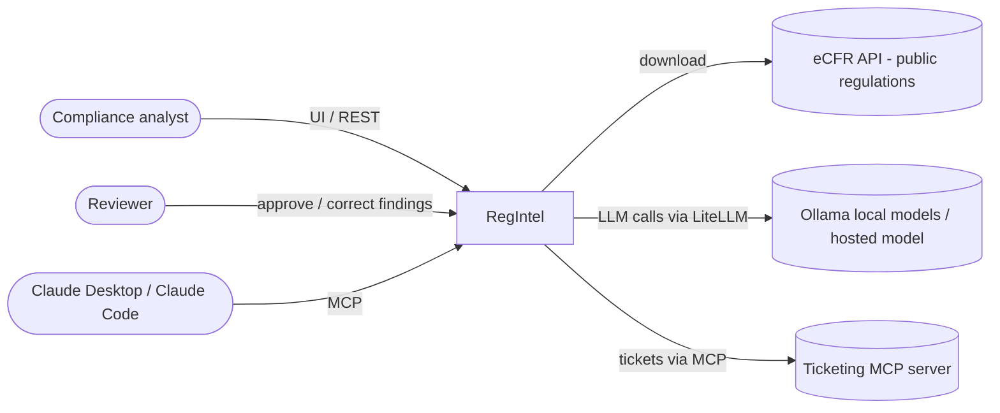
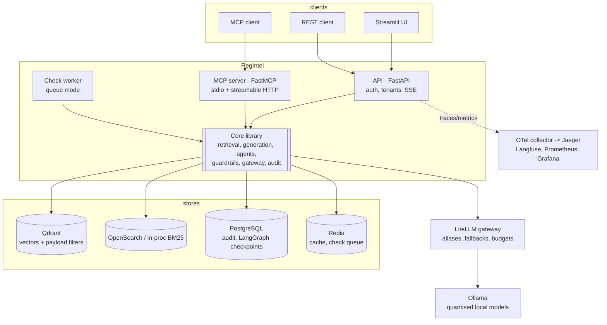
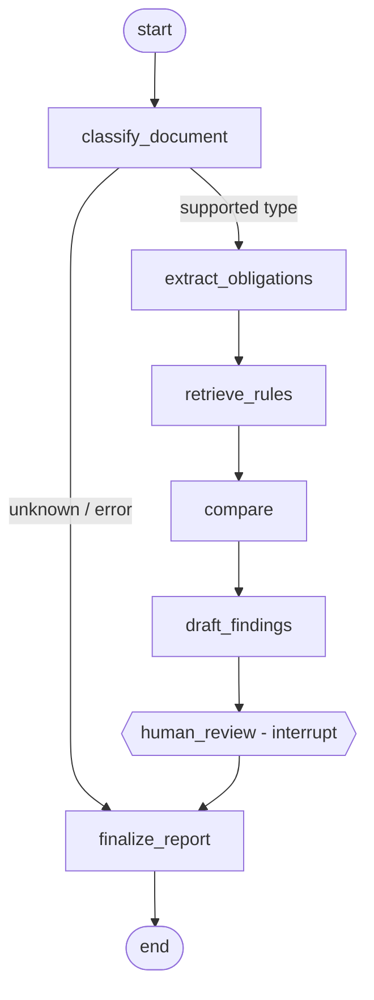

# Architecture

## System context (C4 level 1)



## Containers (C4 level 2)



Every process builds the system through `regintel.container.build_container(settings)`, so the API,
MCP server, worker, evaluation and benchmarks run identical code paths.

## Components

| Package | Responsibility | Key types |
|---|---|---|
| `ingestion` | eCFR XML / Markdown / Docling parsing, structure-aware chunking, manifest pipeline | `ParsedDocument`, `StructureAwareChunker` |
| `retrieval` | Protocols, vector + BM25 retrievers, RRF hybrid, rerankers, query rewrite, configurable pipeline | `Retriever`, `Reranker`, `SecurityContext`, `RetrievalPipeline` |
| `generation` | Versioned prompt registry, context compression, cited answers, abstention, SSE streaming | `PromptRegistry`, `AnswerService`, `Answer` |
| `llm` | The only path to models: routing, budgets, exact cache, fallbacks, cost, metrics | `LLMGateway`, `RoutingPolicy`, `HeuristicProvider` |
| `cache` | In-memory / Redis KV + semantic cache namespaced by tenant + prompt + config | `SemanticCache` |
| `agents` | LangGraph `compliance_check` and `checklist_and_testgen` graphs, service, tools | `ComplianceNodes`, `CheckService`, `RegIntelTools` |
| `guardrails` | PII redaction, injection scanning, untrusted wrapping, output validation, policy | `InjectionScanner`, `PolicyEngine` |
| `mcp_server` | FastMCP server exposing the tools, token verification | `build_server` |
| `audit` / `storage` | Audit events (PII-redacted), documents, chunk catalogue, Qdrant/OpenSearch/Postgres | `AuditEvent`, `DocumentRepository` |
| `observability` | OTel spans, Prometheus metrics, Langfuse generations | `span()`, `metrics.*` |

## Request flows

### Ask (`POST /v1/ask`)

```mermaid
sequenceDiagram
  participant C as Client
  participant A as API
  participant G as Guardrails
  participant R as RetrievalPipeline
  participant L as LLMGateway
  C->>A: question + X-API-Key
  A->>A: key -> SecurityContext(tenant, groups); policy "ask"
  A->>G: redact PII in question
  A->>A: semantic cache lookup (tenant|prompt|config namespace)
  A->>R: (rewrite) -> BM25 + vector (tenant filters in store) -> RRF -> rerank
  R-->>A: top-n chunks
  A->>G: scan chunks for injection; quarantine suspicious ones
  A->>A: compress to token budget; IDF-weighted confidence -> abstain if < min_score
  A->>L: answer.v1 with numbered <untrusted> passages
  L-->>A: text with [n] markers
  A->>G: map [n] -> chunk ids, drop invented ones, redact PII, strip links, escape HTML
  A->>A: audit event (redacted)
  A-->>C: Answer {answer, citations, confidence, abstained}
```

### Compliance check (`POST /v1/checks` ... `/review`)



* **Trust boundary.** `classify_document` and `extract_obligations` are the only nodes that read
  the uploaded text; both call tool-less models and their output is Pydantic-validated
  (`Classification`, `DocumentFacts`). Lines that trip the injection scanner are quarantined
  before extraction, and extracted statements are scanned again. Privileged nodes see only facts.
* **Rules.** Requirements come from a versioned catalogue (`data/catalog/*.yaml`) derived from the
  regulation; each is grounded by retrieving its regulation passages (citations on every finding).
* **Compare.** Statements are pre-filtered per requirement (bounded tokens); the model returns a
  validated `Comparison`; malformed output degrades to `needs_review`, never to `compliant`.
* **Human review.** `interrupt()` pauses the graph; state is checkpointed (Postgres in
  production), so the API can restart and the review still resumes the same thread. The reviewer
  identity comes from the authenticated key, never from the request body.
* **Limits.** Step counter + recursion limit; any node error routes to `finalize_report` with
  status `failed`; `REGINTEL_AGENTS_ENABLED=false` is the kill switch.

### MCP

`search_regulations`, `ask_regulations`, `check_document`, `get_check`, `get_checklist` all call
`RegIntelTools`, which validates arguments, authorises against the caller's `SecurityContext`
(from the bearer token or the stdio identity) and writes an audit event. See [mcp.md](mcp.md).

## Lite mode vs full mode

| Concern | Lite (default, CI) | Full (`make up`) |
|---|---|---|
| Embeddings | `HashingEmbedder` (word + char-trigram feature hashing) | BGE via sentence-transformers |
| Vector store | in-memory, filtered scan | Qdrant (payload filters, int8 quantisation) |
| Keyword | in-process BM25 | in-process BM25 or OpenSearch |
| Reranker | `LexicalReranker` | cross-encoder (ms-marco MiniLM) |
| LLM | `HeuristicProvider` (deterministic, extractive) | LiteLLM -> Ollama (q4) / hosted fallback |
| Cache | in-memory | Redis |
| Checkpoints / audit | memory / JSONL | PostgreSQL |

The heuristic provider is not a language model: it is a transparent rule-based stand-in so that
tests and the eval gate are reproducible without GPUs or API keys. Quality numbers produced in
lite mode measure the *pipeline* (retrieval, grounding, abstention, orchestration); generation
quality with a real model is measured by running the same `make eval` in full mode.

## Decisions

See [adr/](adr/): chunking (0001), hybrid retrieval (0002), LangGraph (0003), local vs hosted
models and the gateway (0004), quarantine pattern (0005), MCP SDK version (0006), offline lite
mode (0007), abstention by IDF-weighted coverage (0008).
